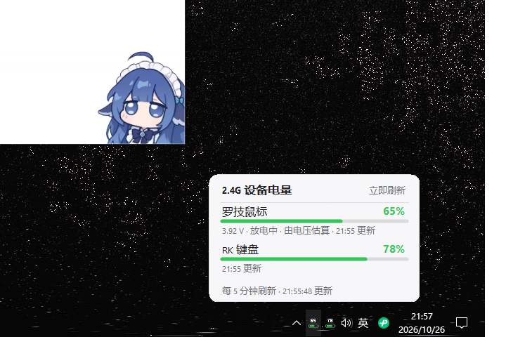

# 2.4G 设备电量显示

Windows 托盘小工具：在任务栏右下角为无线设备显示电量图标（电池图形 + 百分比），鼠标悬停看设备名、电量、电压、充电状态。



## 特性

- **托盘图标**：绿色 ≥60%、橙色 30~59%、红色 <30%、蓝色闪电 = 充电中、灰色 = 读取失败
- **两种图标模式**：分开显示（每台设备一个图标）/ 集合体（只显示一个，取电量最低的那台）
- **两种图标款式**：数字 + 横电池 / 纯电池（竖）
- **左键**弹出电量卡片（所有设备一览，可立即刷新）；**右键**菜单：刷新、重扫设备、换图标、刷新频率、开机自启、深色模式、诊断信息
- **开机自启**（注册表 HKCU Run），可一键关掉，关掉后不会偷偷改回来
- **零依赖**：单个 exe，.NET Framework 4.8，Win10/11 自带，不需要装任何运行库

## 支持的设备

| 设备                  | 连接方式       | 电量来源                    | 精度                |
| ------------------- | ---------- | ----------------------- | ----------------- |
| 罗技 G502 LIGHTSPEED  | 2.4G 接收器   | HID++ 0x1001 电压，用锂电曲线换算 | 估算值（和 G HUB 基本一致） |
| 索尼 DualSense（DS5）手柄 | 蓝牙 / USB 线 | 状态报文里的电量字节              | 10% 一档（固件上报精度）    |

插上新的同类接收器会自动多出一个图标，不用配置。

## 安装

### 直接用

下载 `2.4G电量显示.exe`，双击即可。

### 自己编译

```bat
build.bat
```

只用到系统自带的 `csc.exe`（.NET Framework 4.x），不需要 Visual Studio。编译产物就是目录下的 `2.4G电量显示.exe`。

> 注意：`build.bat` 是 **GBK 编码**，用编辑器改完请确认编码没被转成 UTF-8，否则 cmd 会把中文文件名读成乱码。

## 首次使用

Windows 默认把新程序的托盘图标收进 `^` 里。处理一次即可（系统会记住）：

1. 点任务栏右下角的 `^` 展开隐藏图标
2. 把电池图标拖到任务栏上松手

## 电量是怎么来的

不同设备的取数方式差别很大，这里把踩过的坑记下来。

### 罗技 G502

固件只给电压（HID++ feature `0x1001`），不给百分比。程序用单节锂电池的电压曲线换算（例：3922 mV ≈ 66%），所以是**估算值**。充电时显示闪电，不显示估算百分比。

### 索尼 DualSense（DS5）

DS5 没有「电量查询命令」，电量藏在手柄自己周期性上报的状态报文里，而且**蓝牙和有线是两套报文**：

| 连接方式        | 报告号    | 报文长度 | 取数方式                       | 电量字节    |
| ----------- | ------ | ---- | -------------------------- | ------- |
| 蓝牙          | `0x31` | 78   | `HidD_GetInputReport` 主动索取 | 第 54 字节 |
| 有线（插 USB 线） | `0x01` | 64   | 读一帧流式报文                    | 第 53 字节 |

⚠️ 两个坑：

1. 蓝牙下**流式读取只能拿到简化报文**（`0x01`，只有摇杆数据，没有电量），必须用 `HidD_GetInputReport` 索取 `0x31` 号报告才能拿到完整数据。
2. 插上 USB 线后 PID 仍然是 `0CE6`，但走的是 USB 接口、报文变 64 字节 —— 此时 `HidD_GetInputReport` 反而会失败，得改回流式读。

电量字节的编码（真机实测）：

```
低四位 = 档位 0~10，乘 10 得百分比     例：9 → 90%
高四位 = 供电状态  0 = 放电中，非 0 = 接着电源   例：插线时状态位为 2
```

实测对照：

```
未插线（蓝牙 78 字节）：字节 54 = 0x09 → 档位 9（90%）、状态 0（放电）
插线（USB 64 字节）  ：字节 53 = 0x29 → 档位 9（90%）、状态 2（充电中）
```

程序用**只读方式**打开手柄（不申请写权限），不会占用设备，不影响 Steam / 游戏同时使用手柄。

手柄关机或休眠后读不到报文，图标自动消失；开机连上后自动回来（蓝牙没有插拔通知，靠每 15 秒的轻量检查发现）。

## 排错

右键 → 诊断信息，看当前读数和原始数据。也可以命令行跑：

```
2.4G电量显示.exe --probe
```

会打印枚举到的 HID 接口、每个设备的读数，并存一份到 `%TEMP%\2.4G电量-probe.txt`。

想看手柄原始报文（或给别的设备做逆向），用 `tools/ds5_probe.py`：

```
python tools/ds5_probe.py
```

它枚举 HID 设备、抓输入报文并 dump 十六进制，结果写到同目录的 `ds5-probe.txt`。

`tools/` 下还有两个做对照实验的脚本：

- `ds5_probe2.py` —— 用 `HidD_GetInputReport` 索取指定报告号的完整报文（蓝牙下流式读不到完整报文，靠它救场）
- `ds5_probe3.py` —— 隔几秒取两次报文做差分：一直在变的是时间戳和传感器，**稳定不变的那个字节就是电量**

要给别的设备定位电量字节，按这套路子来：先 dump 原始报文，再做差分对照。

## 目录结构

```
2.4G电量显示.exe      主程序
build.bat             编译脚本（用系统自带的 csc.exe）
src/
  Native.cs           Win32 / HID API 声明
  HidEnum.cs          HID 设备枚举
  Model.cs            设备读数模型
  BatteryCurve.cs     电压 → 百分比曲线
  LogitechHidpp.cs    罗技 HID++ 读取
  DualSenseHid.cs     索尼 DS5 手柄读取（蓝牙 / 有线）
  DeviceMonitor.cs    扫描与轮询
  DeviceWatcher.cs    USB 插拔监听
  BatteryIcon.cs      托盘图标绘制
  PopupCard.cs        电量卡片
  TrayController.cs   托盘与菜单
  Settings.cs         配置读写
  Autostart.cs        开机自启
  Probe.cs            诊断输出
  Program.cs          入口
tools/
  ds5_probe.py        HID 报文探针（排错 / 逆向用）
使用说明.txt           详细中文说明
```

配置文件在 `%APPDATA%\2.4G电量\settings.ini`。

## 许可证

MIT，见 [LICENSE](LICENSE)。
